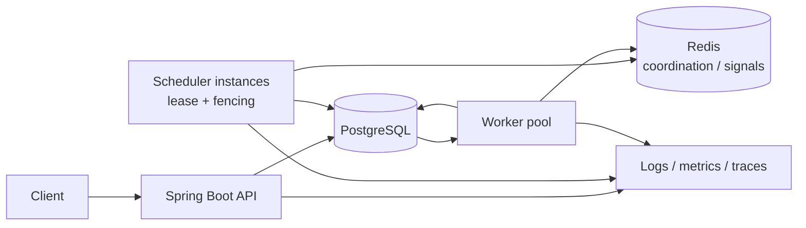

# Distributed Job Scheduler — Design

## Problem and goals

Provide a durable service for submitting and operating asynchronous work. It must schedule one-time and recurring jobs, distribute eligible work to many workers, recover from process failures, and expose job state and history. The initial design favors a small operational footprint and PostgreSQL as the durable source of truth; Redis supports coordination and short-lived signals.

## Functional requirements

- Submit one-time jobs and recurring schedules (cron or fixed interval), with payload, queue, priority, and optional `runAt`.
- Retry failed jobs with configurable maximum attempts and exponential backoff with jitter.
- Cancel queued work and request cooperative cancellation of running work.
- Move exhausted or explicitly rejected work to a dead-letter state/queue, retaining its error and payload for inspection or replay.
- Record worker registration and heartbeats; mark stale workers unavailable and recover their expired leases.
- Elect one active scheduler leader, with a lease and fencing token, to materialize schedules and coordinate cluster-wide scheduling tasks.
- Persist each attempt and state transition in job history.

## Non-functional requirements

- At-least-once execution; handlers must be idempotent because a crash can cause a retry after side effects.
- A committed job cannot disappear when a worker or scheduler leader dies. PostgreSQL is authoritative; leases allow recovery.
- Workers scale horizontally and claim work concurrently without double-claiming a live lease.
- Expose structured logs, metrics (queue age/depth, throughput, retries, lease expiry, worker health), traces, and health endpoints.

## Capacity estimates

Assumptions: 1,000,000 new jobs/day, 500 jobs/s peak submit rate, average retained job row 2 KB, average run-history row 1 KB, 3 attempts/job, and 30-day online retention.

- Average arrivals: `1,000,000 / 86,400 = 11.6 jobs/s`; peak is roughly `43×` average.
- Job rows: `1,000,000 × 30 × 2 KB = 60 GB` raw.
- Run history at 3 attempts: `1,000,000 × 30 × 3 × 1 KB = 90 GB` raw.
- Base raw total is about `150 GB`; indexes, WAL, bloat, and replicas can raise provisioned storage to roughly `300–450 GB`. Payloads should be size-limited and large blobs stored externally.
- Submit writes at peak are `500 inserts/s`. Assuming one run row at claim, one at completion, and one job state update per attempt, 3 attempts imply approximately `500 × (1 + 3 × 3) = 5,000` row mutations/s during a sustained peak, plus heartbeats and schedule work. Batch where possible and partition/archive history as volume grows.

## Data model

Use UUID primary keys, UTC timestamps, JSONB payload/config, and indexes scoped to status and due time. Partition `job_runs` by time when volume warrants it.

- `jobs`: `id`, `queue`, `payload`, `priority`, `status`, `run_at`, `attempt`, `max_attempts`, `idempotency_key`, `schedule_id`, `lease_owner`, `lease_until`, `created_at`, `updated_at`, `last_error`.
- `job_runs`: `id`, `job_id`, `attempt`, `worker_id`, `status`, `started_at`, `finished_at`, `duration_ms`, `error`, `result_summary`.
- `schedules`: `id`, `name`, `cron` or `interval_seconds`, `timezone`, `job_template`, `next_run_at`, `enabled`, `misfire_policy`, `created_at`, `updated_at`.
- `workers`: `id`, `instance_id`, `queues`, `status`, `last_heartbeat_at`, `started_at`, `metadata`.

Constraints include a unique `(queue, idempotency_key)` when a key is supplied, unique `(schedule_id, scheduled_for)` for materialized recurring occurrences (stored as job metadata or a dedicated uniqueness key), and unique `(job_id, attempt)` in `job_runs`.

## API design

JSON REST API under `/api/v1`; errors use `{ "code": "...", "message": "..." }`.

| Endpoint | Request | Response |
| --- | --- | --- |
| `POST /jobs` | `{ "queue":"emails", "payload":{}, "priority":5, "runAt":"...", "maxAttempts":5, "idempotencyKey":"..." }` | `202 { "id":"...", "status":"QUEUED" }` |
| `GET /jobs/{id}` | — | `200 { "id":"...", "status":"...", "attempt":0, "runAt":"...", "lastError":null }` |
| `GET /jobs?status=QUEUED&queue=emails&limit=50&cursor=...` | — | `200 { "items":[...], "nextCursor":"..." }` |
| `POST /jobs/{id}/cancel` | `{}` | `202 { "id":"...", "status":"CANCEL_REQUESTED" }` |
| `GET /jobs/{id}/runs` | — | `200 { "items":[{ "attempt":1, "status":"FAILED", "startedAt":"...", "error":"..." }] }` |
| `POST /schedules` | `{ "cron":"0 */5 * * * *", "timezone":"UTC", "jobTemplate":{...}, "misfirePolicy":"SKIP" }` | `201 { "id":"...", "enabled":true, "nextRunAt":"..." }` |
| `GET /schedules/{id}` | — | `200 { "id":"...", "enabled":true, "nextRunAt":"..." }` |
| `PATCH /schedules/{id}` | `{ "enabled":false }` | `200 { "id":"...", "enabled":false }` |
| `GET /dead-letters?queue=emails` | — | `200 { "items":[...], "nextCursor":"..." }` |
| `POST /dead-letters/{id}/replay` | `{ "runAt":"..." }` | `202 { "id":"...", "status":"QUEUED" }` |
| `GET /health`, `GET /metrics` | — | Health status; Prometheus exposition |

Administrative endpoints require authentication and authorization before production use; worker claim/heartbeat traffic should use a separately authenticated internal API.

## Architecture

The API validates and commits submissions before returning. The scheduler leader materializes due recurring occurrences idempotently, but workers can claim from PostgreSQL independently. Claim with one short transaction using `SELECT ... FOR UPDATE SKIP LOCKED` over due queued jobs ordered by priority and due time, then atomically set `RUNNING`, owner, and lease expiry and insert a run record. A worker extends its lease while executing and records completion/failure in a transaction. If it dies, another worker requeues the expired lease and records the interrupted attempt. Fencing tokens prevent a former leader from writing after losing its lease. Redis is an optimization for wakeups/coordination, never the only copy of a job.

## Failure scenarios

| Scenario | Handling |
| --- | --- |
| Worker crash | Lease expires; recovery requeues or retries the job. The handler may run again, so use idempotency keys for external effects. |
| Leader crash | Leader lease expires; another scheduler acquires it with a higher fencing token. Unique occurrence keys prevent duplicate scheduled jobs. |
| DB failover | Clients retry transient errors with bounded backoff. Acknowledgment is sent only after commit; use synchronous durability appropriate to the deployment. |
| Duplicate submission | Client idempotency key has a unique constraint; return the original job on conflict. |
| Poison job | Bounded retries with exponential backoff and jitter; then retain it in dead-letter state with error and replay controls. |

## Key trade-offs

- **At-least-once vs exactly-once:** exactly-once side effects across arbitrary external systems are not generally achievable. At-least-once plus idempotent handlers and deduplication is practical.
- **Postgres claiming vs Kafka:** Postgres offers transactions, state/history, and simpler operations for the target scale. Kafka can provide higher-throughput event distribution, but requires separate durable job state and reconciliation.
- **Polling vs push:** short, jittered DB polling is easy to recover and does not lose wakeups; it adds query load and latency. Redis notifications can wake pollers quickly, while periodic polling remains the correctness fallback.

## What changes at 100× scale

At 100 million jobs/day and 50,000 jobs/s peak, a single relational claim path and 30-day hot history become bottlenecks. Partition jobs by queue/tenant or hash, shard databases, split archival history to cheaper storage, and use a broker or partitioned dispatch log for high-volume delivery while retaining a durable status store. Isolate scheduler leaders by shard, add admission control and per-tenant quotas, and scale observability pipelines separately. Revisit payload storage, retention, index strategy, and multi-region semantics with measured workload data.
